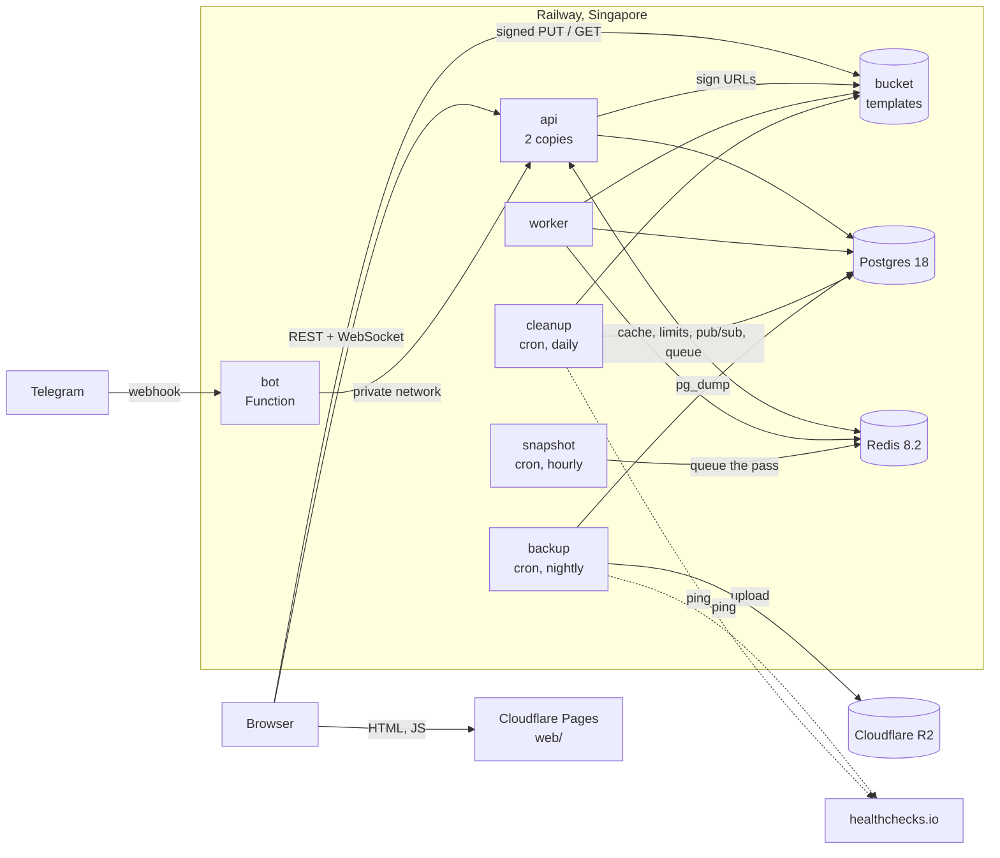

# Rail Canvas

A shared pixel canvas in the style of r/place: players in a space place one pixel at a time, with a
cooldown, and see everyone's pixels live. A Go API, Postgres, Redis and a Vite + React frontend,
run on [Railway](https://railway.com) as a stress test of its service types on the \$5 Hobby plan.

- Site: https://rail-canvas.pages.dev (invite only)
- API: https://rail-canvas-production.up.railway.app/health

It is a learning project: the structure matters more than the features. The plan, every decision and
its reason live in [Notion](https://app.notion.com/p/3ee95a71540581c8af9ac997375758e9); how the code
is built is in [`CLAUDE.md`](CLAUDE.md); operations (restore, rollback, secrets) in
[`docs/runbook.md`](docs/runbook.md).

## Architecture



| Piece | Its job |
| --- | --- |
| `api` | The HTTP API and the WebSocket hub. Two copies; a pixel placed on one reaches sockets on the other through Redis pub/sub |
| Postgres | The source of truth: spaces, users, canvases, the board, every pixel. Row-level security per space |
| Redis | Rebuildable copies and short-lived state: the board cache, cooldowns, rate limits, WebSocket tickets, the job queue. With Redis down nothing fails, it only gets slower |
| bucket | Private. Template images uploaded straight from the browser with signed URLs, hourly PNG snapshots, timelapse GIFs |
| `worker` | The slow jobs (thumbnails, snapshots, timelapses), so the API only does fast things |
| `snapshot`, `cleanup`, `backup` | Cron services: they start on schedule, do their work and exit, so they cost nothing in between |
| `bot` | A Railway Function: Telegram commands to link an account and place pixels through the API |
| `staging` | A second Railway environment with its own Postgres, Redis and bucket, seeded with fake players |

The code is grouped by layer, like the tea-pos app it copies: `handler` (HTTP) calls `service`
(business logic) calls `store` (SQL generated by sqlc). The API contract is
[`api/openapi.yaml`](api/openapi.yaml); Go and TypeScript types are generated from it, and CI fails
if they are out of date.

## How a change ships

```
local branch ─▶ staging ─▶ CI ─▶ staging deploys ─▶ staging tests ─▶ pull request staging → main ─▶ production
```

Every push to `staging` runs CI (tests with a real Postgres and Redis) and deploys the staging
environment, where a few end-to-end checks run against the live services. A release is a pull
request from `staging` into `main`, merged by hand; production only ever gets a commit that passed
on staging. Railway's own settings are code too ([`.railway/railway.ts`](.railway/railway.ts)): the
pull request shows the plan, merging applies it. Migrations run in Railway's pre-deploy step, never
on boot; if one fails, the old version keeps serving.

## Running it locally

Needs Go, Node with pnpm, and a local Postgres (Redis is optional). Copy `.env.example` to `.env`.

```bash
make dev        # the API on :8080
make web-dev    # the frontend on :5173 (web/.env.local sets VITE_API_URL)
make check      # formatting, vet, tests, frontend build
make test-db    # the tests that need a database
make help       # everything else
```

## The numbers

**The bill so far** (2026-10-04 to 2026-10-20, the project's whole life, `railway usage`): **\$0.62**,
production and staging together. Railway estimates **\$1.40 for the month**, inside the \$5 the plan
includes.

| Service | So far |
| --- | --- |
| Postgres | \$0.35 |
| api (2 copies) | \$0.14 |
| Postgres-staging | \$0.03 |
| bot | \$0.03 |
| worker | \$0.03 |
| Redis | \$0.02 |
| Redis-staging | \$0.01 |

By kind: memory \$0.55, CPU \$0.02, egress \$0.02, volume \$0.02. Staging exists only since
2026-10-18. The cron services and the buckets do not appear in Railway's per-service list.

**The load test** (k6 from a laptop in Indonesia against staging, [`ops/loadtest/`](ops/loadtest/)):
10, 25, 50 and 100 players at once, all with zero errors.

| Players | Requests/s | HTTP p95 | HTTP p99 | Placed → seen p95 |
| --- | --- | --- | --- | --- |
| 10 | 4.5 | 75 ms | 96 ms | 71 ms |
| 25 | 11.0 | 122 ms | 210 ms | 133 ms |
| 50 | 22.5 | 119 ms | 183 ms | 127 ms |
| 100 | 44.7 | 162 ms | 289 ms | 241 ms |

At 100 players the API's own p95 was 32 ms and it used 0.2 vCPU at its peak. **100 players for an
hour cost about \$0.15, and about 95% of that is egress**: every pixel goes to every player, so
traffic grows with players × players. Full breakdown and extrapolation: Notion, "Load test results".

## What was learned

**What broke**

- **Creating the staging environment from the settings file.** Railway's IaC engine (beta) made a
  Postgres whose password was the literal text `secret(32, "…")` and a Redis with no variables;
  every service failed. Syncing from production brought the databases without their disks. What
  works: an empty environment, databases added in the dashboard, then the file adopts them by name
- **Service names are project-wide**, so staging's databases and bucket need their own names
- **Railway's Wait for CI waits for every GitHub Actions run on a commit.** A job that waits for the
  deploy must start on `workflow_run`, or the two wait for each other until one times out
- **Every merge redeploys every service**, cron ones included: a release at the full hour once cost
  an hourly snapshot. Releases now avoid :50 to :05
- **A dashboard change after a plan makes the apply fail**; a service created by the file loses Wait
  for CI until a second apply. Settings live in the file, values are pasted before planning

**What cost more, or less, than expected**

- **Far less overall.** The first estimate was \$4 to \$4.50 a month; the real figure is about \$1.40,
  because idle Go services, Postgres and Redis use very little
- **Memory is the bill, not CPU.** Always-on memory is about 90% of it, and Postgres alone more
  than half. CPU is a rounding error at this scale
- **Egress is the bill under load**, and Railway's per-minute estimate showed about half of what the
  clients really received. Measure at the client. The cheapest saving would be compressing the
  64 KB board, a third of the test's traffic
- **No usage limit exists until you set one.** It is now a \$10 hard limit with an alert at \$5

## Layout

| Folder | What is in it |
| --- | --- |
| [`api/`](api/) | The Go module: the API, the worker, the admin and cron commands, migrations, queries |
| [`web/`](web/) | The Vite + React frontend, deployed to Cloudflare Pages |
| [`functions/webhook/`](functions/webhook/) | The Telegram bot, a Railway Function (Bun, one file) |
| [`ops/backup/`](ops/backup/) | The nightly backup image and the restore script |
| [`ops/loadtest/`](ops/loadtest/) | The k6 load test, run from a laptop against staging only |
| [`.railway/`](.railway/) | Railway's services, settings and variables as code |
| [`.github/workflows/`](.github/workflows/) | CI, the Railway plan and apply, the staging tests |
